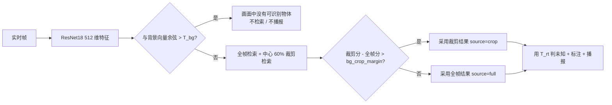

# ResNet18 语音物体识别 Demo

基于本地 ImageNet 预训练 **ResNet18** 的物体识别 Demo：多图录入并保存特征（带物体名称），输入图片返回最相似物体名称与相似度，相似度过低判为未知物体；带简单界面（录入 / 识别 / 查看），重启后特征库仍在。语音链路由百度短语音识别与 Edge TTS 播报组成；界面为 Tab1 多图录入、Tab2 单图识别、Tab3 摄像头实时识别与教学式录入。摄像头实时识别为加分项。

> **交付包默认空库**：`data/features.json` 的 `objects` 为空、不含任何 512 维向量。程序启动不会载入预置向量，也不会扫描样本目录；第一次打开需要先现场录入物体，这正好对应选题书现场演示的第一项。
>
> 报告样本 41 张图放在 `samples/`（`known/` 25、`test/` 10、`unknown/` 6），**仅用于报告复现，不自动入库**，启动流程不读取它们。

## 快速开始（虚拟环境 · 三步）

交付包**不含**建好的 `.venv`（它写死绝对路径、torch CPU + gradio 有几百 MB，不能跨机器搬）。请在本机现场生成，三步即可演示：

```bat
setup_env.bat
run.bat
```

1. `setup_env.bat`：`python -m venv .venv` → 升级 pip → 装齐 `requirements.txt` 里**钉死版本**的依赖 → 验证 `import torch,torchvision,gradio` → 打印「环境就绪，运行 run.bat 启动」。任一步失败都会给中文提示并 `exit /b 1`。
2. `run.bat`：激活 `.venv` 后 `python app.py`，浏览器打开 http://127.0.0.1:7860。
3. **空库现场录入**：交付包默认空库，按下方「首次使用」三步录入新物体，然后识别/未知判断。

Linux/macOS 用等价的 `setup_env.sh` / `run.sh`。**不要往系统 Python 直接 `pip install`**；下文所有 `python ...` 命令均默认已激活 `.venv`（Windows 用 `.venv\Scripts\activate.bat`，或显式写成 `.venv\Scripts\python.exe ...`）。

## 为什么有这个项目

作业要求做一个"能认东西"的本地 Demo，但不能依赖在线识别接口、服务器或手机 App。我们选择 ResNet18 取 512 维特征 + 余弦相似度：模型本地跑、特征库就是一个 JSON 文件，**零部署、可离线、重启不丢数据**。语音识别只用百度短语音识别（录入名称），语音播报用 Edge TTS；缺密钥或依赖时降级为纯键盘操作。

## 首次使用：在空库上现场录入（三步）

交付包的特征库是空的。你的**第一步是在空库上现场录入一个新物体**；下面三步就是到"能识别"的最短路径。

### 第 1 步 · 空库启动，确认是 0

```bash
python tools/demo_cli.py stats
```

预期输出（物体数 / 向量数都是 0）：

```text
特征库: data/features.json
模型: resnet18-imagenet1k-v1  dim=512  阈值=0.8124
物体数: 0   特征向量: 0
（空库，请先用 add 命令录入物体）
```

图形界面同理：`python app.py` 后打开 Tab1，表格为空。

### 第 2 步 · 现场录入一个新物体（每个 ≥5 张，多角度）

用你手边任意一个小物体，从 5 个不同角度各拍一张，放进一个目录（例如 `my_object/`），然后：

```bash
python tools/demo_cli.py add --name 我的水杯 --dir my_object
```

或在 Tab1 输入名称、上传多张图片、点「录入并保存」。预期：`新增 5 条特征`、`全库 5 条`。重复图片按像素摘要自动去重，不会虚增条数。想快速复现课程数据，也可以把 `samples/known/water_cup`（5 张注册图）当作录入来源。

### 第 3 步 · 识别 / 未知判断

换一个角度另拍一张作测试图，或直接用 `samples/test/water_cup/01.jpg`：

```bash
python tools/demo_cli.py recognize --image my_object_test.jpg --top-k 3
```

预期：显示物体名、相似度（含百分比）、是否已知，以及前 3 个近邻。再拿一个没录入的东西试一次，最高相似度低于阈值就显示「未知物体」。

> 阈值 `0.8124` 是**课程 5 物体样本上校准的参考值**，不是通用常数。你现场录入的物体若与课程样本差异较大，建议用 `tools/calibrate.py` 以你自己的测试图重新校准（见「阈值与未知判断」）。

## 环境安装（虚拟环境，一次）

**不再建议用系统 Python 直接 `pip install`**。依赖版本全部钉死在 `requirements.txt`（与项目报告「锁定版本」口径一致），由 `setup_env.bat` 在本机一键装进 `.venv`：

| 依赖 | 钉死版本 | 说明 |
|------|----------|------|
| Python | 3.10+（本机 3.11.9 验证） | 用于建 `.venv` |
| numpy | 1.26.4 | torch 2.2.2 不能配 numpy 2.x，会报 `_ARRAY_API not found` |
| pillow | 10.4.0 | 图片解码与预处理 |
| torch / torchvision | 2.2.2+cpu / 0.17.2+cpu | **CPU 版**，走 PyTorch 官方 CPU 索引 |
| gradio | 4.44.1 | 图形界面（Tab1 录入 / Tab2 识别 / Tab3 实时+教学） |
| huggingface_hub / fastapi / starlette / uvicorn / pydantic | 0.36.0 / 0.115.6 / 0.41.3 / 0.32.1 / 2.10.4 | 传递依赖钉住，否则 `import gradio` 会挂 |
| soundfile / httpx / edge-tts | 可选（默认装齐） | 语音识别/播报；缺密钥时降级为键盘录入 + 文本结果 |
| pytest | ≥ 7.0 | 测试 |

```bat
setup_env.bat
```

> **PyTorch CPU 版**：`torch==2.2.2+cpu` / `torchvision==0.17.2+cpu` 只发布在 PyTorch 官方 CPU 索引，必须带 `--index-url https://download.pytorch.org/whl/cpu`，否则会装到 CUDA 版或不匹配版本。脚本已自动处理；`requirements.txt` 首行也用 `--extra-index-url` 引入该源，使 `pip install -r requirements.txt` 一条命令即可装齐。

> 离线权重拷贝：若目标机器无法联网，把 `resnet18-f37072fd.pth` 放到
> `~/.cache/torch/hub/checkpoints/`（Linux/macOS）或
> `%USERPROFILE%\.cache\torch\hub\checkpoints\`（Windows）；
> 也可设置环境变量 `TORCH_HOME` 指向可写目录。文件名必须与 torchvision 期望的一致（默认即 `resnet18-f37072fd.pth`）。

## 启动图形界面

```bat
run.bat
```

`run.bat` 激活 `.venv` 后运行 `python app.py`，浏览器打开 http://127.0.0.1:7860。界面为 Tab1 多图录入、Tab2 单图识别、Tab3 摄像头实时识别与教学式录入（加分项）。

## 演示前检查

答辩与现场演示前逐条过一遍，任何一条不过就会当场掉链子：

- [ ] **中文字体**：Windows 自带微软雅黑即可；Linux 需装 Noto CJK，否则标注图上的中文显示成方框。
- [ ] **摄像头**：设备管理器里能看到，且没被别的程序占用（Tab3 实时识别用；加分项，讲解时再开）。
- [ ] **麦克风**：系统录音里能看到输入电平；Tab1「语音说名称」用，录不到就退回键盘录入。
- [ ] **Edge TTS 需联网**：播报走微软在线服务，断网时界面会显示「语音播报不可用，请检查网络」，不是程序坏了。
- [ ] **ResNet18 权重已预热**：`~/.cache/torch/hub/checkpoints/resnet18-f37072fd.pth`（Windows 为 `%USERPROFILE%\.cache\torch\hub\checkpoints\`）已存在，避免现场第一次运行临时下载约 45 MB。

## 使用

### 命令行（验收与批处理）

```bash
# 逐个物体录入（默认写仓库内 data/features.json）
python tools/demo_cli.py add --name power_bank --dir samples/known/power_bank
python tools/demo_cli.py add --name earphone   --dir samples/known/earphone

# 查看特征库（物体数 / 向量条数 / 阈值）
python tools/demo_cli.py stats

# 单图识别，展示前 3 个近邻
python tools/demo_cli.py recognize --image samples/test/power_bank/01.jpg --top-k 3

# 批量 Top-1 评测（目录结构 samples/test/<物体名>/*.jpg）
python tools/demo_cli.py eval --dir samples/test --json

# 阈值校准（见下方"阈值与未知判断"）
python tools/calibrate.py --known-dir samples/test --unknown-dir samples/unknown
```

> 特征库默认路径是仓库内 `data/features.json`（交付包为空库）。用 `--library` 或环境变量 `RN18_LIBRARY_PATH` 可指向其它文件；一台机器上只用一个库，不要混用。

所有命令都支持 `--json`，便于把结果贴进报告或做自动化断言。

### 测试

```bash
python -m pytest tests -q                      # 178 passed, 4 skipped（P5.1 实现后）
RUN_RESNET_TESTS=1 python -m pytest tests -q   # 含真实权重端到端
```

默认跳过 4 项：3 项真实 ResNet 端到端（需 `RUN_RESNET_TESTS=1`）、1 项真实 Edge TTS 合成（需联网 + `RN18_TTS_LIVE=1`）。必须联网的 TTS 用例在无网环境不跑，不会伪造结果。

### 图形界面

- **Tab1 · 多图录入**：输入物体名称（键盘或语音回填）→ 上传该物体的多张图片 → 点「录入并保存」。重复图片按像素摘要去重，不会虚增向量条数。
- **Tab2 · 单图识别**：上传一张测试图 → 点「开始识别」。页面显示物体名、相似度（含百分比）、是否未知，以及前 3 个近邻和标注图（绿框=已知，红框=未知）；识别成功后自动播报当次结果。
- **Tab3 · 实时识别（加分项）**：打开摄像头后画面按约 0.3 s/帧送入 `recognize_stream`，实时叠加名称与相似度，未知显示「未知物体」；TTS 按「结果变化 + 4 s 冷却」播报。没有摄像头时可上传预置帧序列模拟视频流。
- **Tab3 · 背景自适应（P5.1）**：首次进入实时页先收集 **20** 帧（其中前 **2** 帧只做预热）建立当前机位背景，统计行显示学习进度与「背景已建立」；之后每帧先过背景门，命中显示「画面中没有可识别物体（背景）」，不检索、不播报。可点「重新学背景」重来，也可关掉「背景门」回到未启用背景门时的单路行为做对照。背景只写 `data/background.json`，不进入物体库。用预置帧序列做**实时识别**时请至少准备 20 张；「用帧序列抓 5 帧」教学入口走自己的预热逻辑，不受这 20 张限制。
- **Tab3 · 教学式录入**：点「教它」→ 先丢 2 帧预热 → 按 0.2 s 以上间隔抓 5 帧 → 录音说名称 → ASR 回填（可键盘修改）→ 确认入库。入库复用 `add_to_library` / `save_library`，重启后仍在；教学期间识别与 TTS 同时暂停，退出时清空冷却计时。
- **刷新特征库**：从磁盘重新读取 `data/features.json`，用于验证"重启后特征库仍在"。

语音识别封装在 `voice/asr.py`（百度短语音识别），已接进 Tab1 与 Tab3 教学态：录音 → 识别 → 回填物体名称，用户可改后再入库。未配置密钥时按钮置灰、提示用键盘输入，`asr()` 不调用，程序不崩溃；键盘录入始终可用。语音播报用 Edge TTS（`voice/tts.py`），识别结果成功后自动播报，失败时显示「语音播报不可用，请检查网络」。

**注册图有两种来源**：Tab1 离线上传，以及 Tab3 教学抓帧（每次 5 张，同一物体可多次教学累计）。教学帧只能作为注册图，**不能当测试图**；验证教学效果必须换角度或距离另拍测试图。

## 配置（`.env`）

语音识别需要百度智能云的 API Key 与 Secret Key。把仓库里的 `.env.example` 复制为 `.env` 并填入：

```ini
# .env.example 内容（复制为 .env 后填值）
BAIDU_ASR_API_KEY=你的API_KEY
BAIDU_ASR_SECRET_KEY=你的SECRET_KEY
# 选填：1537=标准版（默认），80001=极速版
BAIDU_ASR_DEV_PID=1537
```

密钥优先级（高 → 低，每个键独立取第一个非空值）：

1. 进程环境变量 `BAIDU_ASR_API_KEY` / `BAIDU_ASR_SECRET_KEY` / `BAIDU_ASR_DEV_PID`
2. `RN18_ENV_FILE` 指向的文件
3. `~/.rn18/.env`
4. 仓库根目录 `.env`

密钥**只**从环境变量或 `.env` 读取，绝不写死在代码里，也不进日志（异常信息只会带错误码，不会拼接含 Secret 的请求 URL）。`.env` 已在 `.gitignore` 中，不会被提交。

图形界面的其他可选环境变量：

| 变量 | 默认值 | 说明 |
|------|--------|------|
| `RN18_LIBRARY_PATH` | `data/features.json` | 特征库 JSON 路径 |
| `RN18_BACKGROUND_PATH` | `data/background.json` | 实时背景向量 JSON 路径（与特征库分开） |
| `RN18_REALTIME_CONFIG` | `data/realtime.json` | 实时三阈值配置路径 |
| `RN18_HOST` | `127.0.0.1` | 监听地址（演示只给本机） |
| `RN18_PORT` | `7860` | 监听端口 |

## 阈值与未知判断（重要）

判定规则：**最高相似度 < 阈值** 即判为"未知物体"。交付包 `data/features.json` 的 `threshold` 字段为 **`0.8124`**，程序启动时自动生效。

> `0.8124` 是在**课程 5 物体样本**上、用未参与录入的测试图校准得到的**参考值**（推导见 REPORT.md §3）。交付包默认空库；你现场录入的物体若与课程样本差异较大，建议用 `tools/calibrate.py` 以你自己的测试图重新校准，不要把这个数当成通用常数。

校准依据（课程样本复跑）：两条分布的实际数值（`samples/test` 10 张已知 + `samples/unknown` 6 张未知）

| 分布 | 样本数 | min | max | mean |
|------|-------|-----|-----|------|
| 已知类（测试图，未参与录入） | 10 | 0.8828 | 0.9734 | 0.9290 |
| 未知类（3 类未录入物体） | 6 | 0.6282 | 0.7421 | 0.6897 |

两条分布间隙 0.1407，取中点 `(0.8828 + 0.7421) / 2 = 0.8124`，两侧余量各约 0.070。写入后复跑：已知 10/10 通过（准确率 100%），未知 6/6 拒识（误报率 0%）。

注意区分三类值：

- `features.json` 里的 `threshold = 0.8124` 是课程样本上的校准**参考值**，程序优先用它；
- `core/recognize.py` 的 `DEFAULT_THRESHOLD = 0.60` 只是**库没有校准值时的代码兜底**，不是本项目的结论，报告结论里不出现它。用 `python tools/demo_cli.py threshold` 可以查看当前生效值；
- `data/realtime.json` 的 `threshold_realtime = 0.75`、`threshold_bg = 0.90`、`bg_crop_margin = 0.05` 是**未在标准流程下校准的占位值**，不是结论。

重新校准（换数据或换角度重拍后）：

```bash
# 1. 看两条分布，读建议阈值
python tools/calibrate.py --known-dir samples/test --unknown-dir samples/unknown

# 2. 写回特征库
python tools/demo_cli.py threshold --set 0.8124

# 3. 复跑两组验证
python tools/demo_cli.py eval --dir samples/test --json
python tools/unknown_check.py --dir samples/unknown
```

> **校准集纪律**：校准只能用 `test/` 与 `unknown/`，注册图（`known/`）绝不允许进校准集，否则阈值会自己污染自己。本次三类样本 md5 两两零重叠。

## 背景自适应（P5.1，实时链路）

实时画面里物体通常只占一部分，整帧特征会被背景稀释。这里加一层**背景门**和**中心裁剪第二路**，但不引入目标检测/分割模型，也不接在线服务：



- 背景学习：进实时页后收集 20 帧，丢前 2 帧（黑帧/过曝），对剩余 18 帧逐维取**中位数**再 L2 归一化；写入 `data/background.json`，**绝不写进 `features.json`**。丢弃预热帧后不足 10 帧时直接报错，不拿半截数据凑。
- 背景门：每帧先算与背景的余弦；`bg_sim > T_bg` 判为「画面中没有可识别物体」，直接返回 `state="no_object"`，不进入检索、不产生播报文本。
- 中心裁剪：PIL 裁 `0.2~0.8` 的中心 60%，只有「裁剪分 - 全帧分 > `bg_crop_margin`」才采用；结果里用 `source=full|crop` 标记。
- 实时阈值：用 `T_rt` 判未知，**不套用静态阈值 0.8124**；静态链路完全不变。
- 关闭开关：`realtime.json` 的 `bg_gate_enabled=false`（或界面「背景门」复选框）时，`recognize_stream` 回到 P5.1 之前的单路识别（全帧 + 库内静态阈值），标注图字节不变，便于现场对照。

三个阈值分开存，静态阈值仍以特征库为准：

| 键 | 当前值 | 来源 / 状态 |
|----|--------|-------------|
| `threshold_static` | **0.8124** | 课程样本上校准的参考值，写进 `features.json`；**保持不变** |
| `threshold_realtime` | **0.75（占位）** | **未在标准流程下校准**：实时帧物体占比小、分数整体偏低，0.75 只是低于静态阈值的保守占位；**没有把 0.8124 搬过来** |
| `threshold_bg` | **0.90（占位）** | **未在标准流程下校准**：空场景/物体帧分布确定前，先用高阈值避免把物体误门掉 |
| `bg_crop_margin` | **0.05（占位）** | **未在标准流程下校准**：裁剪结果至少比全帧高 0.05 才采用 |
| `bg_gate_enabled` | **true** | 背景门开关；`false` 回到未启用背景门时的单路行为，便于对照 |

配置文件 `data/realtime.json`（与 `features.json` 并列）：

```json
{
  "schema": "rn18-realtime-config",
  "version": 1,
  "threshold_static": 0.8124,
  "threshold_realtime": 0.75,
  "threshold_bg": 0.9,
  "bg_crop_margin": 0.05,
  "bg_gate_enabled": true
}
```

> 注意：`threshold_static` 即使写在文件里，程序读配置时仍会用 `features.json` 的 `threshold` 覆盖它，避免两处数字打架。`threshold_realtime` / `threshold_bg` / `bg_crop_margin` 当前值**不是校准结论**，报告里保留「未验证/占位」标注。

真机自检（一条命令给出背景基线、空场景最大误报分、物体分数分布与阈值是否合理）：

```bash
# 离线帧：frames/background/*.jpg + frames/<物体名>/*.jpg + frames/unknown/<物体名>/*.jpg
python tools/realtime_check.py --frames ~/.rn18/data/realtime_frames \
    --library ~/.rn18/data/features.json

# 摄像头：前 1/3 时间空场景，之后按库里的物体顺序逐个放入
python tools/realtime_check.py --camera 0 --seconds 30 \
    --library ~/.rn18/data/features.json
```

输出包含：空场景 `bg_sim` 的 min/median/max、空场景最高候选分与超过 `T_rt` 的误报次数、每个物体在场时的分数 min/median/max、当前三个阈值以及 `T_bg`/`T_rt` 是否可分的判定。

`--camera` 模式需要 `.venv\Scripts\python -m pip install opencv-python`（**仅自检脚本**需要，应用本身不依赖 opencv；没有摄像头/没装 opencv 时脚本会给出明确报错并建议改用 `--frames`，不会静默卡住）。`--write` 只写 `data/realtime.json`，不动 `features.json`；两分布重叠时脚本**不给数字**，直接要求重拍，避免把拍脑袋的值写进配置。

## 数据与特征库格式

- 注册图：`samples/known/<物体名>/*.jpg`（每物体 5 张；`power_bank` / `water_cup` / `earphone` / `keyboard` / `mouse`）
- 测试图：`samples/test/<物体名>/*.jpg`（每物体 2 张，与注册图严格分开，不参与录入）
- 未知样本：`samples/unknown/<物体名>/*.jpg`（3 类各 2 张：乌龙茶、充电头、剪刀，只用于阈值校准）
- 规模：5 物体 × 7 张（5 注册 + 2 测试）= 35 张，另加 3 类未知 × 2 张 = 6 张，合计 41 张；**仅用于报告复现，启动不读取、不自动入库**
- 清单：`data/manifest.csv` 是课程样本的**唯一入库清单**，35 行 = 25 张 known + 10 张 test，按**文件字节 SHA-256** 去重，35 个摘要全不相同（CSV 第 4 列列名沿用 `md5`，实际值为 SHA-256）。路径列沿用采集时的 `data/...`，对应本包 `samples/...`；哈希按文件字节计算，改名或移动后仍可核对。
- 特征库：`data/features.json`，JSON，版本 1，512 维，L2 归一化；**交付包为空库（0 物体、0 条向量）**，原子写入，重启不丢
- 实时背景：`data/background.json`，独立 schema `rn18-background`，只存 512 维背景向量；删掉它只会让实时页重新学背景，不影响物体库
- 实时配置：`data/realtime.json`，存 `threshold_static` / `threshold_realtime` / `threshold_bg` / `bg_crop_margin` / `bg_gate_enabled`；`threshold_static` 的真值仍以 `features.json` 为准

## 文档与交付物

- [项目报告 REPORT.md](REPORT.md) — 系统功能 / 实现方法 / 测试结果 / 成员分工
- [关键函数讲解卡 docs/function_cards.md](docs/function_cards.md) — 抽问高频函数说明
- [现场演示脚本 docs/demo_script.md](docs/demo_script.md) — 验收演示分步清单
- [启动说明 docs/STARTUP.md](docs/STARTUP.md) — 环境安装 + 启动命令速查
- 核心层说明见 [core/README.md](core/README.md)
- [报告样本说明 samples/README.md](samples/README.md) — 41 张样本的用途与不自动入库声明

## 许可证

课程大作业，仅供教学演示使用。
