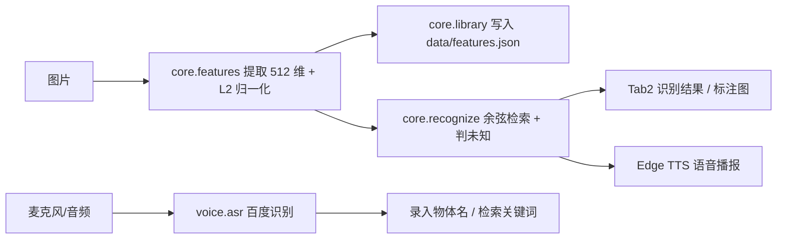

# 项目报告：基于 ResNet18 和语音交互的物体识别 Demo

> 文档状态：P6a（已知物体部分）。未知物体判断所需的样本**尚未采集**，相关结论在本报告中明确标注为待补，不引用任何未验证的结论。

## 1. 系统功能

本 Demo 在**单台电脑、完全本地**完成选题书要求的全部必做项：

| 必做项 | 实现方式 | 状态 |
|--------|----------|------|
| 多图录入并保存特征（带物体名称） | Tab1 录入 → 512 维特征写入 `data/features.json` | ✅ 已实现 |
| 输入图片返回最相似名称与相似度 | 余弦相似度 top-k 检索 | ✅ 已实现 |
| 相似度低判未知物体 | `score < threshold` 判未知 | ⚠️ 逻辑已实现，阈值占位 `0.60`，**待独立测试图校准** |
| 语音说出物体名称 | 百度短语音识别（`voice/asr.py`） | ✅ 已实现，缺 Key 自动降级 |
| 语音播报识别结果 | Edge TTS 封装 | ⚠️ 接口预留，**TTS 封装尚未落地**（见 §4 边界） |
| 简单界面完成录入/识别/查看 | Gradio Tab1 录入 / Tab2 识别 | ✅ 已实现 |
| 重启后特征库仍在 | JSON 原子写入 + 启动时加载 | ✅ 已实现 |

唯一加分项（摄像头实时识别）单独评估，不计入必做验收。

## 2. 实现方法

### 2.1 总体架构

双链路共用同一个核心层 `core/`，界面层（`app.py`）与语音层（`voice/asr.py`）都只调用核心层函数，互不耦合。

### 2.2 关键技术决策

- **去掉 ResNet18 的 `fc` 层**：ImageNet 的 1000 类分类头对自定义物体无意义；去掉后输出 512 维池化特征，可直接做"以图搜图"式检索。
- **L2 归一化**：归一化后余弦相似度退化为点积，检索是一次 `(N,512) @ (512,)` 矩阵乘法；向量模长不再影响阈值，阈值可跨图片复用。
- **复用 `weights.transforms()`**：与权重训练时一致的预处理，避免手写预处理导致特征分布偏移。
- **按物体取最大相似度**：多视角注册时"只要有一张注册图很像就认为该物体很像"，对多视角录入更友好（代价是注册图要真实清晰、无重复）。
- **JSON 特征库而非数据库**：满足"重启后特征库仍在"，零依赖、可读、约 300 KB；用 SQLite / FAISS 属工程化扩张，不加分。
- **阈值三级优先级**：显式参数 > 特征库 `threshold` > 占位 `0.60`；占位值绝不当作最终结论。
- **密钥不写死**：只从环境变量或 `.env` 读取，repr 屏蔽 Secret，异常只带错误码不拼接含 Secret 的 URL。

## 3. 测试结果

### 3.1 数据集说明（口径）

- 已采集 **5 个物体 × 7 张 = 35 张**照片：充电宝、水杯、耳机、键盘、鼠标。
- 拆分：**每物体 5 张注册图 + 2 张测试图**，注册图与测试图**严格分开**。
- **未知物体样本尚未采集**：按人类决定暂缓至交付前补齐（≥3 类，每类 2~3 张），因此"未知判断"与阈值定稿在 P6b 阶段完成。

### 3.2 已知物体检索（Top-1）

入库命令与批量评测命令已就绪（`tools/demo_cli.py add` / `eval`）。**10 张已知测试图的逐张 Top-1 明细与平均分待 Python 全栈工程师在自有运行环境跑出后回填此处。**

> 占位：以下表格为模板，数据待回填。

| 测试图 | 真实物体 | 预测物体 | 相似度 | 是否正确 |
|--------|----------|----------|--------|----------|
| （待回填） | 充电宝 | — | — | — |
| … | … | … | … | … |
| **合计** | — | — | — | **/10** |

### 3.3 单元与端到端测试

- `core` 逻辑测试（假编码器，秒级，无需 torch）：覆盖特征提取、特征库增查、检索、判未知。
- 真实 ResNet18 端到端测试（设 `RUN_RESNET_TESTS=1` 才跑，首次下载权重）。

### 3.4 边界与降级

- 缺百度 Key：`is_asr_configured()` 为 `False` → 界面置灰语音入口，键盘录入与文本结果显示照常，程序不崩溃。
- 空特征库：识别时返回"未知物体"并提示先录入，不抛未捕获异常。
- 特征库损坏：加载失败抛 `ValueError`，不静默覆盖磁盘文件。

## 4. 成员分工

> 以下为按选题书与 crew 协作划分的分工草案，最终以实际提交记录为准。

| 模块 | 负责 | 交付 |
|------|------|------|
| 核心层 `core/`（特征、特征库、识别） | 实现 + 架构契约 | 可复用函数与单测 |
| 图形界面 `app.py`（Tab1 录入 / Tab2 识别） | 实现 | Gradio 界面 |
| 语音识别 `voice/asr.py`（百度 ASR） | 实现 | 录入名称 / 检索关键词 |
| 语音播报（Edge TTS 封装） | 待落地 | ⚠️ 接口预留，封装未实现 |
| 阈值校准 `tools/calibrate.py` + 验收 | 实现 + 测试 | 已知分布已实现，未知分布待补 |
| 文档与交付物（本报告、README、函数卡、演示脚本） | 文通通（文档） | P6a 当前文档 |

## 5. 当前边界与待办（P6b）

1. **未知物体判断**：样本采集（≥3 类 × 2~3 张）→ `calibrate.py --unknown-dir` 出未知分布 → 定阈值 → 写回 `features.json`。
2. **语音播报（Edge TTS）**：封装尚未实现，需补 `voice/tts.py` 并在 Tab2 接入"播报识别结果"。
3. **摄像头实时识别**：加分项，单独评估，不阻塞必做验收。
