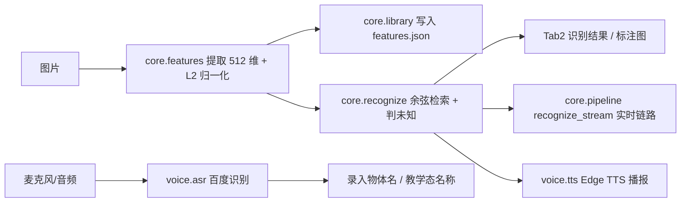

# 项目报告：基于 ResNet18 和语音交互的物体识别 Demo

> 版本：**v1.0.0 最终交付**。静态阈值 `0.8124` 是在**课程 5 物体样本**上、用未参与录入的测试图校准得到的**参考值**，写入特征库；`data/realtime.json` 中的 `threshold_realtime`（0.75）、`threshold_bg`（0.90）、`bg_crop_margin`（0.05）**未在标准流程下校准**，是占位值，不作为结论。
> 本报告的离线数值（10/10、6/6、178 passed 等）来自课程样本复跑，命令见各节；实机结论按小组电脑上实际演示的口述如实记录（见 §5），不补数字、不编次数。交付包默认空库，现场录入后可用 `samples/` 样本复现。

## 1. 系统功能

本 Demo 在**单台电脑、完全本地**完成选题书要求的全部必做项，另附一个加分项：

| 必做项 | 实现方式 | 状态与证据 |
|--------|----------|------|
| 多图录入并保存特征（带物体名称） | Tab1 录入 → 512 维特征写入 `features.json` | ✅ 已实现；课程样本 5 物体 × 5 张 = 25 条向量（§3.1） |
| 输入图片返回最相似名称与相似度 | 余弦相似度物体级 top-1 检索 | ✅ 已实现；10 张测试图 Top-1 = 10/10（§3.2） |
| 相似度低判未知物体 | 最高相似度 `< 0.8124` 判未知 | ✅ 已实现并校准；未知 6/6 拒识、误报 0%（§3.4） |
| 语音说出物体名称 | 百度短语音识别极速版 → Tab1 / Tab3 回填名称 | ✅ 已接线（录音 → 16k 单声道 → 识别 → 回填；未配 Key 时按钮置灰、键盘兜底） |
| 语音播报识别结果 | Edge TTS → Tab2 / Tab3 自动播放 | ✅ 已实现（每次播当次结果；实时链路结果变化 + 4 s 冷却；失败降级提示） |
| 简单界面完成录入/识别/查看 | Gradio Tab1 录入 / Tab2 识别 / Tab3 实时+教学 | ✅ 已实现 |
| 重启后特征库仍在 | JSON 原子写入 + 启动时加载 | ✅ 已实现（`save_library` 原子替换、`load_library` 启动读取） |

加分项：摄像头实时识别（Tab3）+ 教学式录入。摄像头实时页已在小组电脑上实机测试，但存在手部干扰这一已知局限（见 §5.2）。

## 2. 实现方法

### 2.1 总体架构

双链路共用同一个核心层 `core/`，界面层（`app.py`）与语音层（`voice/asr.py`、`voice/tts.py`）都只调用核心层函数，互不耦合。实时链路与静态链路共用 `core/pipeline.py` 的 `recognize_static` / `recognize_stream`，没有第二套特征或检索逻辑。



### 2.2 关键技术决策

- **去掉 ResNet18 的 `fc` 层**：ImageNet 的 1000 类分类头对自定义物体无意义；去掉后输出 512 维池化特征，可直接做"以图搜图"式检索。
- **L2 归一化**：归一化后余弦相似度退化为点积，检索是一次 `(N,512) @ (512,)` 矩阵乘法；向量模长不再影响阈值，阈值可跨图片复用。
- **复用 `weights.transforms()`**：与权重训练时一致的预处理，避免手写预处理导致特征分布偏移。
- **按物体取最大相似度**：多视角注册时"只要有一张注册图很像就认为该物体很像"，对多视角录入更友好（代价是注册图要真实清晰、无重复）。
- **JSON 特征库而非数据库**：满足"重启后特征库仍在"，零依赖、可读、约 300 KB；用 SQLite / FAISS 属工程化扩张，不加分。
- **阈值三级优先级**：显式参数 > 特征库 `threshold`（课程样本校准的参考值 `0.8124`）> 代码兜底 `DEFAULT_THRESHOLD`（见 `core/recognize.py`）。兜底值只在"库未经校准"时生效，**不是最终结论**，也不写进测试结论。
- **密钥不写死**：只从环境变量或 `.env` 读取，repr 屏蔽 Secret，异常只带错误码不拼接含 Secret 的 URL。

### 2.3 实时背景自适应（P5.1）

目标：摄像头前的环境复杂，整帧特征容易被背景主导，出现"背景被认成已录入物体"或"物体在场却认不出"。实现仍走 ResNet18 + 余弦检索，不引入检测/分割模型，也不接在线服务。

```mermaid
flowchart LR
    A[实时帧] --> B[512 维特征]
    B --> C{cos(帧, BG) > T_bg?}
    C -->|是| D[画面中没有可识别物体<br/>不检索 / 不播报]
    C -->|否| E[全帧检索 + 中心 60% 裁剪检索]
    E --> F{裁剪分 - 全帧分 > bg_crop_margin?}
    F -->|是| G[采用裁剪结果 source=crop]
    F -->|否| H[采用全帧结果 source=full]
    G --> I[用 T_rt 判未知 + 标注 + 播报]
    H --> I
```

- **背景学习**：进实时页先收 20 帧，丢前 2 帧（黑帧/过曝），对剩余 18 帧逐维取中位数并 L2 归一化；写入独立的 `data/background.json`，schema 为 `rn18-background`。丢弃预热帧后不足 10 帧直接报错。背景不写入 `features.json`，不计入物体数量，不进入 P6b 校准集。Gradio 4.44 没有 tab 切换事件，学习由实时页的**第一帧**触发；没开摄像头/没播放帧序列时不会空转。
- **背景门**：每帧先算与背景向量的余弦，`bg_sim > T_bg` 时返回 `state="no_object"`，不检索、不产生播报文本；界面统计行显示「背景已建立」与 T_rt/T_bg。可点「重新学背景」重来，也可关掉背景门回到未启用背景门时的单路行为做对照。
- **中心裁剪第二路**：PIL 裁 `0.2~0.8` 的中心 60%，只有「裁剪分 - 全帧分 > `bg_crop_margin`」才采用，`StreamResult.source` 标记 `full`/`crop`。
- **阈值分离**：`threshold_static`（库里的 0.8124，不动）、`threshold_realtime`（占位 0.75）、`threshold_bg`（占位 0.90）、`bg_crop_margin`（占位 0.05）、`bg_gate_enabled` 写在 `data/realtime.json`。**T_rt/T_bg/margin 未在标准流程下校准**，三项都标「占位/未验证」，不由代码编造结论；**没有把 0.8124 直接用于实时链路**。
- **自检工具**：`tools/realtime_check.py` 支持 `--frames`（离线、不依赖 opencv）与 `--camera`（opencv 可选依赖），输出背景相似度基线（min/median/max）、空场景 30 帧最大误报分/次数、物体分数分布与阈值建议；`--write` 只写 `realtime.json`。两分布重叠时脚本拒绝给数字，避免把拍脑袋的值写进配置。

## 3. 测试结果

> **口径说明**：本节的 10/10、6/6、178 passed 等结果，均基于课程 **25 条注册图样本**（5 物体 × 5 张）复跑得到；样本随交付包放在 `samples/`，**仅用于报告复现，不自动入库**。**交付包默认空库**（`data/features.json` 的 `objects` 为空、不含任何向量），现场手动录入后可用 `samples/` 复现这些数字。表里的 `data/known/...`、`data/test/...` 为采集时的相对路径，对应本包 `samples/known/...`、`samples/test/...`；下面的复现命令请用 `samples/` 下的目录。

### 3.1 数据集说明（口径）

| 用途 | 物体数 | 每物体张数 | 合计 | 是否入库 |
|------|--------|-----------|------|----------|
| 注册图 `data/known/<物体>/` | 5 | 5 | 25 | 入库（25 条向量） |
| 测试图 `data/test/<物体>/` | 5 | 2 | 10 | 不入库，仅评测 |
| 未知样本 `data/unknown/<物体>/` | 3 | 2 | 6 | 不入库，仅校准 |
| **合计** | — | — | **41** | — |

- 5 个已知物体：`power_bank`、`water_cup`、`earphone`、`keyboard`、`mouse`。
- 3 个未录入物体：乌龙茶、充电头、剪刀。
- `data/manifest.csv` 是**唯一入库清单**：known 25 行 + test 10 行，按**文件字节 SHA-256** 去重，摘要全不相同（CSV 第 4 列列名沿用 `md5`，实际值为 SHA-256）。
- 未知样本 6 张与 known（25）、test（10）逐字节比对 **md5 零重叠**；known 与 test 之间同样零重叠。**校准集不含任何注册图**。
- 注册图与测试图拍摄角度/距离不同，测试图未参与录入。

### 3.2 已知物体检索（Top-1）

用真实特征库（25 条）复跑 10 张未参与录入的测试图：

| 测试图 | 真实物体 | 预测 | 相似度 | ≥ 阈值 0.8124 | 正确 |
|---|---|---|---|---|---|
| data/test/earphone/01.jpg | earphone | earphone | 0.9610 | 是 | 是 |
| data/test/earphone/02.jpg | earphone | earphone | 0.9219 | 是 | 是 |
| data/test/keyboard/01.jpg | keyboard | keyboard | 0.9050 | 是 | 是 |
| data/test/keyboard/02.jpg | keyboard | keyboard | 0.9237 | 是 | 是 |
| data/test/mouse/01.jpg | mouse | mouse | 0.9568 | 是 | 是 |
| data/test/mouse/02.jpg | mouse | mouse | 0.9734 | 是 | 是 |
| data/test/power_bank/01.jpg | power_bank | power_bank | 0.8828 | 是 | 是 |
| data/test/power_bank/02.jpg | power_bank | power_bank | 0.9239 | 是 | 是 |
| data/test/water_cup/01.jpg | water_cup | water_cup | 0.9392 | 是 | 是 |
| data/test/water_cup/02.jpg | water_cup | water_cup | 0.9026 | 是 | 是 |

- **Top-1：10/10，准确率 100%**
- **平均余弦 0.9290**；最低 0.8828（power_bank/01），最高 0.9734（mouse/02）
- 最低分高于阈值 0.8124 有 **0.0704** 余量，说明已知类没有被阈值误杀
- 复现：`python tools/demo_cli.py eval --dir samples/test --json`

### 3.3 阈值校准：两条分布（`tools/calibrate.py` 真实输出）

```bash
python tools/calibrate.py --known-dir samples/test --unknown-dir samples/unknown
```

```text
特征库: .../features.json
当前（占位/已校准）阈值: 0.8124

[已知类] 测试图 10 张
  最高相似度  min=0.8828  max=0.9734  mean=0.9290
    earphone   n=2   min=0.9219 max=0.9610
    keyboard   n=2   min=0.9050 max=0.9237
    mouse      n=2   min=0.9568 max=0.9734
    power_bank n=2   min=0.8828 max=0.9239
    water_cup  n=2   min=0.9026 max=0.9392

[未知类] 样本 6 张
  最高相似度  min=0.6282  max=0.7421  mean=0.6897

建议阈值（已知 min 与未知 max 中点）: 0.8124
→ 用 `python tools/demo_cli.py threshold --set <值>` 写回特征库。
```

| 分布 | 样本数 | min | max | mean |
|------|-------|-----|-----|------|
| 已知类（test 10 张） | 10 | 0.8828 | 0.9734 | 0.9290 |
| 未知类（unknown 6 张） | 6 | 0.6282 | 0.7421 | 0.6897 |

**阈值取法**：已知类最小值 0.8828 与未知类最大值 0.7421 之间的分离间隙为 **0.1407**，取中点为 `(0.8828 + 0.7421) / 2 = 0.8124`，两侧余量各约 **0.070**（已知侧 0.0704，未知侧 0.0703）。

**为什么不用其他取法**：
- 取更低的点（贴近未知最大值）会放大误报风险，而未知样本只有 6 张，样本偏差会让边界不稳；
- 取更高的点（贴近已知最小值）会牺牲召回，且 power_bank/01 的 0.8828 是已知侧离群低点，再往上顶会先杀掉它；
- 中点法在两侧间隔近似对称时使两类错误概率最均衡，也是 `calibrate.py` 的可复现输出，便于答辩时解释来源。

写入配置：

```bash
python tools/demo_cli.py threshold --set 0.8124
# {"threshold": 0.8124, "saved": true}
```

### 3.4 未知样本拒识验证（阈值写入后复跑）

| 未知图 | 真实物体 | 库里最近物体 | 最高分 | 判定 | 结果 |
|---|---|---|---|---|---|
| 乌龙茶1.jpg | 乌龙茶 | water_cup | 0.6893 | 未知物体 | ✅ 正确拒识 |
| 乌龙茶2.jpg | 乌龙茶 | water_cup | 0.7059 | 未知物体 | ✅ 正确拒识 |
| 充电头1.jpg | 充电头 | power_bank | 0.7421 | 未知物体 | ✅ 正确拒识 |
| 充电头2.jpg | 充电头 | earphone | 0.7362 | 未知物体 | ✅ 正确拒识 |
| 剪刀1.jpg | 剪刀 | mouse | 0.6366 | 未知物体 | ✅ 正确拒识 |
| 剪刀2.jpg | 剪刀 | mouse | 0.6282 | 未知物体 | ✅ 正确拒识 |

- **未知拒识率 6/6 = 100%，误报率 0/6 = 0%**
- 最高分样本：充电头1.jpg，0.7421，距阈值 −0.0703
- 复现：`python tools/unknown_check.py --dir samples/unknown`（全正确拒识时退出码 0，出现误报返回 1）；原始输出见 `docs/evidence/p6b_verification.txt`，校准输出见 `docs/evidence/p6b_calibration.txt`

**外形相近物体的专项说明（充电头 vs 已录入的充电宝）**：

充电头是本次最接近已知类的未知物体，两张分别被判为 `power_bank`（0.7421，库里最近图 `power_bank/03.jpg`）与 `earphone`（0.7362）。它确实是未知样本里的最高分，但**离已知类最低分 0.8828 仍有 0.1407 的差距**，因此**没有把阈值逼高**：若为它上抬阈值，就得超过 0.8828，直接牺牲 power_bank/01 这张已知测试图的召回（0.8828 会掉到阈值下）。取 0.8124 时两侧各留 0.070，兼顾了"充电头判未知"和"充电宝判已知"。

两张充电头分属不同最近邻（一张像充电宝、一张像耳机），说明它的高分并非稳定地贴着某一个已知物，而是"整体都沾一点"，这正是外观相近但材质/结构不同的表现，也说明只用单张注册图做阈值会不稳——现有 5 张多视角注册压住了这个风险。

> 局限：未知样本仅 3 类各 2 张，样本量小。0.8124 是课程样本上的参考值，分离间隙虽然宽（0.1407），但离群样本出现时阈值可能需微调；现场若录入与课程样本差异较大的物体，建议用 `tools/calibrate.py` 重新校准。

### 3.5 单元与端到端测试

```bash
python -m pytest tests -q                     # 178 passed, 4 skipped（P5.1 实现后）
RUN_RESNET_TESTS=1 python -m pytest tests -q  # 含真实权重端到端
```

- 环境：Python 3.11.9（`setup_env.bat` 在 `.venv` 中实跑）/ torch 2.2.2+cpu / torchvision 0.17.2+cpu / numpy 1.26.4 / gradio 4.44.1。应用依赖在 `requirements.txt` 中全部钉死版本（含 5 个传递依赖），与 README 「环境安装」锁定表一致。真实权重端到端用例默认跳过，未在本机联网下载权重。
- 默认运行跳过 4 项：3 项真实 ResNet 端到端用例（需 `RUN_RESNET_TESTS=1`）、1 项真实 Edge TTS 联网用例（需 `RN18_TTS_LIVE=1`）。
- 新增覆盖：`test_background.py`（20 帧丢 2 帧中位数、10 帧下限、余弦边界、save/load 校验、与特征库分离）、`test_bg_gate.py`（门命中检索/TTS 调用 0 次、裁剪 margin、门关等价、T_rt 不套静态阈值）、`test_pipeline.py` / `test_realtime.py` / `test_realtime_check.py` 适配新接口。

### 3.6 边界与降级

- **未配置百度 Key**：`voice.asr.is_asr_configured()` 返回 `False`，界面启动时「语音识别名称」按钮 `interactive=False`，点击只提示"未配置语音识别密钥，请用键盘输入"，**不调用 `asr`**；命令行直接调用 `asr()` 则抛 `AsrNotConfigured`（可捕获的预期状态，不是崩溃）。键盘录入与文本结果显示照常。
- **语音播报**：网络/依赖失败时界面显示「语音播报不可用，请检查网络」，识别结果与特征库不受影响。实时链路按「结果变化 + 4 s 冷却」节流，教学态同时暂停识别与 TTS，退出时清空冷却。
- **空特征库**：识别时返回"未知物体"并提示先录入，不抛未捕获异常。交付包默认就是空库。
- **特征库损坏**：加载失败抛 `ValueError`，不静默覆盖磁盘文件。
- **阈值未校准**：库里没有 `threshold` 时回落到代码兜底值并可用 `--threshold` 临时覆盖；该兜底值不是本项目的结论，报告结论不采用它。

### 3.7 P5.1 背景自适应：离线自测与真机待校准项

**单元/集成测试**（本机实跑）：

```text
178 passed, 4 skipped, 12 warnings in 19.31s
```

**当前阈值与状态**（全部写在 `data/realtime.json`）：

| 键 | 当前值 | 状态 |
|----|--------|------|
| `threshold_static` | 0.8124 | 课程样本上校准的参考值，写进特征库，**不动** |
| `threshold_realtime` | 0.75 | **未在标准流程下校准**的保守占位；不是 0.8124，也不是实时结论 |
| `threshold_bg` | 0.90 | **未在标准流程下校准**的保守占位 |
| `bg_crop_margin` | 0.05 | **未在标准流程下校准**的裁剪采用 margin |
| `bg_gate_enabled` | true | 背景门开关；false 时回到未启用背景门时的单路行为，便于对照 |

**没有做的事（避免把占位值写成结论）**：`tools/realtime_check.py` 的真机阈值校准尚未在标准流程下执行，因此没有伪造"空场景 30 秒无误报""物体 1 秒内识别""移走 1–2 秒恢复"这类数据。`realtime_check.py --camera 0 --seconds 30` 仍需在小组电脑上实跑，再把建议值人工确认后写回 `data/realtime.json`；在此之前，报告与口头汇报不声称实时阈值已校准。摄像头实时页本身已在小组电脑上实机测试（见 §5），这与"实时阈值未校准"是两件事。

**P5.1 验证清单（离线部分已过，真机部分待做）**：

| 验证点 | 方式 | 状态 |
|--------|------|------|
| 收集 20 帧、丢前 2 帧、逐维中位数、L2 归一化 | `test_background.py` 512 维假编码器手算 | ✅ |
| 丢弃预热帧后不足 10 帧报错 | `test_background.py` | ✅ |
| 余弦边界 1 / 0 / -1，严格 `>` 判背景 | `test_background.py` | ✅ |
| `save` → `load` 往返；非 512 维/未归一化拒绝 | `test_background.py` | ✅ |
| 背景文件与 `features.json` 分离、库哈希不变 | `test_background.py` | ✅ |
| 背景门命中不检索、不生成播报文本 | `test_bg_gate.py` 打桩断言调用 0 次 | ✅ |
| 裁剪差值 ≤ margin 用 full，> margin 用 crop | `test_bg_gate.py` | ✅ |
| `bg_gate_enabled=False` 与未启用背景门时逐帧等价 | `test_bg_gate.py` 比较 `recognition` 与标注字节 | ✅ |
| 实时链路使用 T_rt，不套 0.8124 | `test_bg_gate.py` / `test_pipeline.py` | ✅ |
| 自检脚本离线模式可跑、只写 `realtime.json` | `test_realtime_check.py` | ✅ |
| 空场景 30 s 无误报、物体 1 s 内识别、移走 1–2 s 恢复 | **真机摄像头** | 未验证/占位 |

## 4. 成员分工

负责人：安效甲
选择题目：☑ 选题一 物体识别

| 成员 | 主要分工 |
|---|---|
| 成员一 安效甲（组长） | 总体方案设计与核心识别算法：ResNet18 特征提取（去掉 fc 层、512 维、L2 归一化）、余弦相似度检索、未知判断、阈值校准。负责 `core/features.py`、`core/recognize.py`、`tools/calibrate.py` 及对应单测，并统稿项目报告 |
| 成员二 何成 | 特征库与数据：JSON 特征库逐条存向量、原子写入与重启加载；课程数据集（5 物体 × 5 张注册图、独立测试图、3 类未录入物体）采集整理与 `manifest.csv`。负责 `core/library.py`、`tools/demo_cli.py` 及对应单测 |
| 成员三 陈智豪 | 界面与现场演示：Gradio 三标签页（录入 / 静态识别 / 实时识别）、录入与识别事件链、结果标注图。负责 `app.py`、`core/visualize.py`、`docs/demo_script.md` 及界面事件测试 |
| 成员四 卢瑞涛 | 语音与实时链路：百度短语音识别（16 kHz 重采样）、Edge TTS 播报与节流、摄像头实时识别与教学式录入、背景自适应。负责 `voice/asr.py`、`voice/tts.py`、`core/pipeline.py`、`core/background.py` 及对应单测 |

> 集成联调、单元与端到端测试、运行说明与项目报告由四人共同复核，安效甲统稿。

开发过程中使用大模型辅助查询与参考代码，关键模块由本人复核并说明。

## 5. 实机结论与未验证项

本章按小组电脑上实际演示的口述如实记录：§5.1 是实机确认项，§5.3 是尚未实测、照实保留「未验证/占位」的项。不补数字、不编次数，也不伪造任何实验结果、截图或开发记录。

### 5.1 实机确认

| 项目 | 实机结论 |
|------|----------|
| 语音识别（百度短语音识别） | 实机确认可用，真人说话回填名称正常 |
| 语音播报（Edge TTS） | 实机确认可用，中文正常，播报当次识别结果 |
| 标注图 | 中文显示正常 |
| 摄像头实时页（加分项） | 已实机测试，但存在手部干扰：手举物体时常被当成目标，属**已知局限** |

### 5.2 摄像头手部干扰：根因与使用建议

**根因**：整帧 ResNet18 特征没有"目标区域"的概念，阈值只管分数高低，无法区分这一帧的贡献来自手还是物体；界面上的标注框是**整图状态框，不是目标检测框**。选题书不要求定位物体，本项目未引入检测模型，也没有实现手部剔除。

**使用建议**（演示时用来减轻干扰，不是已实现的功能）：

- 把物体居中、尽量占满画面；
- 手退出画面后再判定；
- 等连续多帧结果稳定后再采信。

### 5.3 未验证 / 占位

| 项目 | 状态 |
|------|------|
| `tools/realtime_check.py` 真机阈值校准（`T_rt` / `T_bg` / `bg_crop_margin`） | 未验证/占位：0.75 / 0.90 / 0.05 仍未在标准流程下校准 |
| 权重离线现场首跑（`resnet18-f37072fd.pth` 已在演示机缓存目录、首跑不联网） | 未验证/占位 |
| 现场四项演示的连贯走通（多图录入 / 识别 / 未知判断 / 语音交互 同场一次走完） | 未验证/占位 |
| 复杂背景下的表现 | 未验证/占位 |
