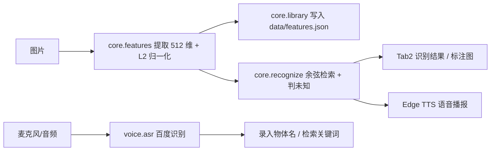

# 项目报告：基于 ResNet18 和语音交互的物体识别 Demo

> 文档状态：P6a（已知物体部分）。未知物体判断所需的样本**尚未采集**，相关结论在本报告中明确标注为待补，不引用任何未验证的结论。

## 1. 系统功能

本 Demo 在**单台电脑、完全本地**完成选题书要求的全部必做项：

| 必做项 | 实现方式 | 状态 |
|--------|----------|------|
| 多图录入并保存特征（带物体名称） | Tab1 录入 → 512 维特征写入 `data/features.json` | ✅ 已实现 |
| 输入图片返回最相似名称与相似度 | 余弦相似度 top-k 检索 | ✅ 已实现 |
| 相似度低判未知物体 | `score < threshold` 判未知 | ⚠️ 逻辑已实现，阈值占位 `0.60`，**未经未知样本校准** |
| 语音说出物体名称 | 百度短语音识别（`voice/asr.py`） | ⚠️ 模块已实现并有单测；**界面尚未接线**（`app.py` 当前无语音按钮） |
| 语音播报识别结果 | Edge TTS | ⚠️ **P4 未实现，接口待定**（见 §3.5） |
| 简单界面完成录入/识别/查看 | Gradio Tab1 录入 / Tab2 识别 | ✅ 已实现 |
| 重启后特征库仍在 | JSON 原子写入 + 启动时加载 | ✅ 已实现 |

唯一加分项（摄像头实时识别）单独评估，不计入必做验收。

## 2. 实现方法

### 2.1 总体架构

双链路共用同一个核心层 `core/`，界面层（`app.py`）与语音层（`voice/asr.py`）都只调用核心层函数，互不耦合。



> 图中语音链路是**模块级设计**，不代表已接进界面：`voice/asr.py` 已实现并有测试，TTS 为 P4 待实现；两者目前都还没有接入 `app.py` 的按钮。

### 2.2 关键技术决策

- **去掉 ResNet18 的 `fc` 层**：ImageNet 的 1000 类分类头对自定义物体无意义；去掉后输出 512 维池化特征，可直接做"以图搜图"式检索。
- **L2 归一化**：归一化后余弦相似度退化为点积，检索是一次 `(N,512) @ (512,)` 矩阵乘法；向量模长不再影响阈值，阈值可跨图片复用。
- **复用 `weights.transforms()`**：与权重训练时一致的预处理，避免手写预处理导致特征分布偏移。
- **按物体取最大相似度**：多视角注册时"只要有一张注册图很像就认为该物体很像"，对多视角录入更友好（代价是注册图要真实清晰、无重复）。
- **JSON 特征库而非数据库**：满足"重启后特征库仍在"，零依赖、可读、约 300 KB；用 SQLite / FAISS 属工程化扩张，不加分。
- **阈值三级优先级**：显式参数 > 特征库 `threshold` > 占位 `0.60`；占位值绝不当作最终结论。
- **密钥不写死**：只从环境变量或 `.env` 读取，repr 屏蔽 Secret，异常只带错误码不拼接含 Secret 的 URL。

## 3. 测试结果

### 3.1 数据集说明（口径）

- 已采集 **5 个物体 × 7 张 = 35 张**照片：power_bank、water_cup、earphone、keyboard、mouse。
- 拆分：**每物体 5 张注册图 + 2 张测试图**，注册图与测试图**严格分开**；特征库共 **25 条**向量（5 × 5）。
- `data/manifest.csv` 是**唯一入库清单**：35 行 = 25 张 known + 10 张 test，按**文件字节 SHA-256** 去重，35 个摘要全不相同。
- **未知物体样本尚未采集**：按人类决定暂缓至交付前补齐（≥3 类，每类 2~3 张），因此"未知判断"与阈值定稿在 P6b 阶段完成。

### 3.2 已知物体检索（Top-1）

用真实特征库（25 条，5 物体 × 5 张注册图）复跑 10 张未参与录入的测试图，逐张结果如下：

| 测试图 | 真实物体 | 预测 | 相似度 | 正确 |
|---|---|---|---|---|
| data/test/earphone/01.jpg | earphone | earphone | 0.961028 | 是 |
| data/test/earphone/02.jpg | earphone | earphone | 0.921930 | 是 |
| data/test/keyboard/01.jpg | keyboard | keyboard | 0.904972 | 是 |
| data/test/keyboard/02.jpg | keyboard | keyboard | 0.923729 | 是 |
| data/test/mouse/01.jpg | mouse | mouse | 0.956832 | 是 |
| data/test/mouse/02.jpg | mouse | mouse | 0.973432 | 是 |
| data/test/power_bank/01.jpg | power_bank | power_bank | 0.882759 | 是 |
| data/test/power_bank/02.jpg | power_bank | power_bank | 0.923915 | 是 |
| data/test/water_cup/01.jpg | water_cup | water_cup | 0.939184 | 是 |
| data/test/water_cup/02.jpg | water_cup | water_cup | 0.902633 | 是 |

- **Top-1：10/10**
- **平均余弦：0.929041**；最低 **0.882759**（power_bank/01），最高 **0.973432**（mouse/02）
- 10 张全部高于占位阈值 `0.60`。

> **阈值 0.60 仍是占位值**，只用已知类测试图验证了"已知不会掉到阈值以下"，**尚未用未知类样本校准**，不能当作最终结论。

### 3.3 阈值校准（`tools/calibrate.py` 真实输出）

```bash
python tools/calibrate.py --known-dir data/test --library data/features.json
```

```text
[已知类] 测试图 10 张
  最高相似度  min=0.8828  max=0.9734  mean=0.9290
    earphone   n=2   min=0.9219 max=0.9610
    keyboard   n=2   min=0.9050 max=0.9237
    mouse      n=2   min=0.9568 max=0.9734
    power_bank n=2   min=0.8828 max=0.9239
    water_cup  n=2   min=0.9026 max=0.9392

[未知类] 待补数据（未知类样本未采集，验收前补齐 ≥3 类各 2~3 张）

建议阈值：未知类样本补齐后才会计算。当前不得把占位值当作最终结论。
```

只有一条真实分布（已知类）；**未知类分布尚无数据**，工具显式输出"待补数据"，不生成建议阈值，也不存在第二条分布。

### 3.4 单元与端到端测试

```bash
python -m pytest -q --ignore=tests/test_app.py
# 73 passed, 3 skipped in 1.31s
```

- `tests/test_app.py` 因本机未安装 gradio 整体 skip（3 项 skipped 即来自该文件），界面事件逻辑待有 gradio 的环境补跑。
- 其余 73 项覆盖：特征提取（假编码器）、特征库增查与持久化、余弦检索、判未知、ASR 配置四级优先级。
- 真实 ResNet18 端到端测试由 `RUN_RESNET_TESTS=1` 控制，默认跳过，首次运行需下载权重。

### 3.5 边界与降级

- **未配置百度 Key**：`voice.asr.is_asr_configured()` 返回 `False`，`asr()` 抛 `AsrNotConfigured`（**可捕获的预期状态，不是崩溃**）。界面上的"语音入口置灰"是**预留接口、尚未接线**——当前 `app.py` 没有语音按钮，键盘录入与文本结果显示照常。
- **语音播报**：Edge TTS 封装属于 P4，**尚未实现**，不存在可演示的播报路径。
- **空特征库**：识别时返回"未知物体"并提示先录入，不抛未捕获异常。
- **特征库损坏**：加载失败抛 `ValueError`，不静默覆盖磁盘文件。

## 4. 成员分工

> 以下为按选题书与 crew 协作划分的分工草案，最终以实际提交记录为准。

| 模块 | 负责 | 交付 |
|------|------|------|
| 核心层 `core/`（特征、特征库、识别） | 实现 + 架构契约 | 可复用函数与单测 |
| 图形界面 `app.py`（Tab1 录入 / Tab2 识别） | 实现 | Gradio 界面 |
| 语音识别 `voice/asr.py`（百度 ASR） | 实现 | 模块 + 单测，界面接线待 P3 收口 |
| 语音播报（Edge TTS 封装） | P4 待实现 | ⚠️ 未实现，接口待定 |
| 阈值校准 `tools/calibrate.py` + 验收 | 实现 + 测试 | 已知分布已实现，未知分布待补 |
| 文档与交付物（本报告、README、函数卡、演示脚本） | 文通通（文档） | P6a 当前文档 |

## 5. 当前边界与待办（P6b）

1. **未知物体判断**：样本采集（≥3 类 × 2~3 张）→ `calibrate.py --unknown-dir` 出未知分布 → 定阈值 → 写回 `features.json`。
2. **语音播报（Edge TTS）**：P4 未实现，需补 `voice/tts.py` 并在 Tab2 接入"播报识别结果"。
3. **语音按钮接线**：`voice/asr.py` 已实现，但尚未接进 `app.py`；需补录音入口与 `AsrNotConfigured` 的置灰处理。
4. **摄像头实时识别**：加分项，单独评估，不阻塞必做验收。
